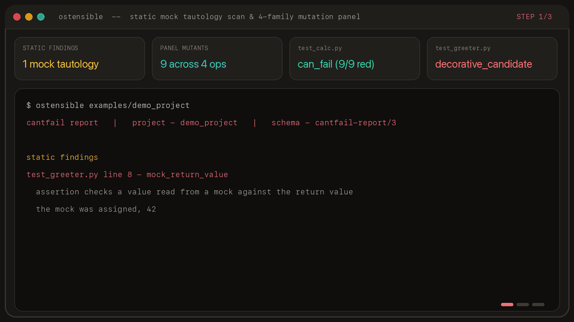
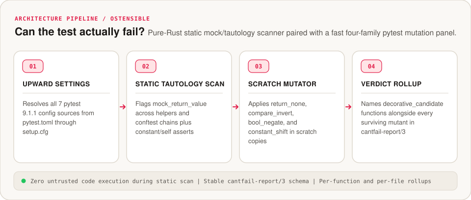
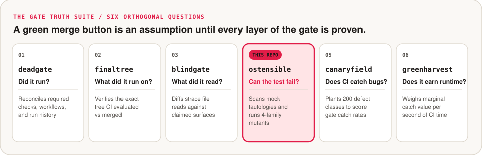

<p align="center">
  <a href="https://github.com/david-engelmann/ostensible">
    <picture>
      <source media="(prefers-color-scheme: dark)" srcset="https://raw.githubusercontent.com/david-engelmann/ostensible/main/docs/media/ostensible-lockup-dark.svg">
      
    </picture>
  </a>
</p>

<h3 align="center">Mutate code under test and scan mock tautologies to convict tests that cannot fail.</h3>

<p align="center">AI coding agents routinely ship green tests that assert a mock returns what the mock was configured to return, or execute code without asserting anything falsifiable. <code>ostensible</code> combines a pure-Rust static tautology scanner with a fast four-family <code>pytest</code> mutation panel so decorative tests are named on the pull request alongside the exact mutants that walked through them.</p>

<p align="center">
  <a href="https://github.com/david-engelmann/ostensible/blob/main/docs/GUIDE.md"><b>Operator Guide</b></a> |
  <a href="https://david-engelmann.github.io/ostensible/">Published Docs</a> |
  <a href="https://github.com/david-engelmann/ostensible/tree/main/examples">Examples</a> |
  <a href="https://github.com/david-engelmann/ostensible/blob/main/docs/ARCHITECTURE.md">Architecture</a> |
  <a href="https://github.com/david-engelmann/ostensible/blob/main/docs/FORMATS.md">Wire Formats</a> |
  <a href="https://github.com/david-engelmann/ostensible/blob/main/docs/COMPARISON.md">Comparison</a> |
  <a href="https://github.com/david-engelmann/ostensible/blob/main/docs/FAQ.md">FAQ</a> |
  <a href="https://github.com/david-engelmann/ostensible/releases">Releases</a>
</p>

<p align="center">
  <a href="https://github.com/david-engelmann/ostensible/actions/workflows/ci.yml"></a>
  <a href="https://david-engelmann.github.io/ostensible/"></a>
  <a href="https://github.com/david-engelmann/ostensible/blob/main/Cargo.toml"></a>
  <a href="https://github.com/david-engelmann/ostensible/blob/main/LICENSE"></a>
</p>

<p align="center">
  
</p>

<p align="center"><sub>Every terminal line above comes from running the ostensible release binary against examples/demo_project.</sub></p>

## What this is

Agent written suites flood repos with tests that cannot fail for a real reason, including tests that assert a mock returns what the mock was told to return. Ostensible applies a fixed panel of small, fast mutations per test file and reports the tests that stayed green under every applicable mutant. A decorative test is named in plain language on the pull request, next to the mutant that walked through it. The boundary with its siblings is one sentence. Ostensible asks whether a test can fail, canaryfield asks whether the harness catches planted defects, greenharvest asks which tests earn their runtime.

<p align="center">
  <picture>
    <source media="(prefers-color-scheme: dark)" srcset="https://raw.githubusercontent.com/david-engelmann/ostensible/main/docs/media/how-it-works-dark.svg">
    
  </picture>
</p>

## Install

Install a prebuilt binary on Linux or macOS with the checksum-verifying installer script.

```sh
curl -fsSL https://raw.githubusercontent.com/david-engelmann/ostensible/main/install.sh | sh
export PATH="$HOME/.local/bin:$PATH"
```

Or install via `cargo-binstall` or from source with Cargo (Rust 1.80 or newer).

```sh
cargo binstall --git https://github.com/david-engelmann/ostensible ostensible
cargo install --git https://github.com/david-engelmann/ostensible --locked
```

From a local checkout, `cargo build --release --locked` places the binary at `target/release/ostensible` (Windows `.zip` archives ship on the [Releases](https://github.com/david-engelmann/ostensible/releases) page).

## Quickstart

Ostensible executes `pytest` through the first `python3` executable on `PATH`. Activate your project virtual environment first (avoiding `pip install -e .` on `src/` layouts in favour of `pythonpath = ["src"]` in `pyproject.toml` so scratch copies import mutated code), then pass the project folder.

```sh
ostensible examples/demo_project
```

Running over `examples/demo_project` prints the verbatim `cantfail-report/3` text report below (or sorted-key JSON under `--json`).

```
cantfail report
project - demo_project
schema - cantfail-report/3

static findings
test_greeter.py line 8 - mock_return_value - assertion checks a value read from a mock against the return value the mock was assigned, 42

test file verdicts
test_calc.py - can_fail
  function - test_add_one - can_fail
    this function turned red under 3 of 9 mutants in the fixed panel
    mutant that walked through - calc.py - return_none at line 6 - return value age >= 18
    mutant that walked through - calc.py - return_none at line 10 - return value True
    mutant that walked through - calc.py - compare_invert at line 6 - comparison age >= 18 operator 0
    mutant that walked through - calc.py - bool_negate at line 10 - boolean constant True
    mutant that walked through - calc.py - constant_shift at line 6 - numeric constant 18 moved plus one
    mutant that walked through - calc.py - constant_shift at line 6 - numeric constant 18 moved minus one
  function - test_is_adult_boundary - can_fail
    this function turned red under 4 of 9 mutants in the fixed panel
    mutant that walked through - calc.py - return_none at line 2 - return value x + 1
    mutant that walked through - calc.py - return_none at line 10 - return value True
    mutant that walked through - calc.py - bool_negate at line 10 - boolean constant True
    mutant that walked through - calc.py - constant_shift at line 2 - numeric constant 1 moved plus one
    mutant that walked through - calc.py - constant_shift at line 2 - numeric constant 1 moved minus one
  function - test_enabled - can_fail
    this function turned red under 2 of 9 mutants in the fixed panel
    mutant that walked through - calc.py - return_none at line 2 - return value x + 1
    mutant that walked through - calc.py - return_none at line 6 - return value age >= 18
    mutant that walked through - calc.py - compare_invert at line 6 - comparison age >= 18 operator 0
    mutant that walked through - calc.py - constant_shift at line 2 - numeric constant 1 moved plus one
    mutant that walked through - calc.py - constant_shift at line 2 - numeric constant 1 moved minus one
    mutant that walked through - calc.py - constant_shift at line 6 - numeric constant 18 moved plus one
    mutant that walked through - calc.py - constant_shift at line 6 - numeric constant 18 moved minus one
  this file turned red under 9 of 9 mutants in the fixed panel
test_greeter.py - decorative_candidate
  function - test_fetch_returns_what_it_was_told - decorative_candidate
    decorative candidate - this function stayed green under every applicable mutant in the fixed panel
    mutant that walked through - greeter.py - return_none at line 2 - return value 'hello'
  decorative candidate - every judged function in this file stayed green under every applicable mutant in the fixed panel

A surviving mutant is evidence about this fixed panel only. It does not prove a test is worthless and a killed mutant does not prove a test is strong.
```

## Running it

```
ostensible [-h | --help] [--json] [--timeout SECONDS] <project>
```

The report prints as text, or as JSON under `--json`. The timeout bounds each single test file run and stands at 30 seconds where no flag gives it. The runs the tool makes are `pytest` runs, read under the `python3` the path provides, and the naming settings of the project are read from the one config source `pytest` itself would use.

## Verification and Performance

Run the full local verification gate from a clean checkout.

```sh
cargo test --locked
cargo fmt --check
cargo clippy --all-targets
cargo package --locked
```

| Stage | Mechanism | Complexity and Isolation |
| --- | --- | --- |
| Upward config discovery | Pure-Rust TOML and INI readers across 7 `pytest 9.1.1` sources | Sub-millisecond upward directory walk, zero Python spawn |
| Static tautology scan | Pure-Rust Python 3.12 lexer, AST parser, NFKC normalizer, and `conftest.py` dataflow | Zero untrusted code execution, linear in test-tree size |
| Dynamic mutation panel | 4 operators (`return_none`, `compare_invert`, `bool_negate`, `constant_shift`) in scratch copies | `1` baseline run + `M` applicable mutant runs per passing test file (`11` `pytest` runs on `examples/demo_project`) |

## The Gate Truth Suite

<p align="center">
  <picture>
    <source media="(prefers-color-scheme: dark)" srcset="https://raw.githubusercontent.com/david-engelmann/ostensible/main/docs/media/gate-truth-arc-dark.svg">
    
  </picture>
</p>

| Tool | Question answered | Primary evidence |
| --- | --- | --- |
| [deadgate](https://github.com/david-engelmann/deadgate) | Did the required check actually run? | Branch protection, workflow YAML, and job history |
| [finaltree](https://github.com/david-engelmann/finaltree) | What tree did CI actually evaluate? | Commit and tree lineage across merge queues |
| [blindgate](https://github.com/david-engelmann/blindgate) | What files did the gate actually read? | Linux `strace` descriptor and path reconstruction |
| [ostensible](https://github.com/david-engelmann/ostensible) | Can the test actually fail? | Static tautology scan and 4-family `pytest` mutants |
| [canaryfield](https://github.com/david-engelmann/canaryfield) | Does the harness catch planted defects? | 200 seeded Python defect classes across real gates |
| [greenharvest](https://github.com/david-engelmann/greenharvest) | Which tests earn their CI runtime? | Marginal defect-catch value per second of execution |

## Documentation

| If you want to... | Read |
| --- | --- |
| Browse the searchable handbook with diagrams | [Published documentation](https://david-engelmann.github.io/ostensible/) |
| Install, configure CI workflows, and run day-two operations | [Operator Guide](https://github.com/david-engelmann/ostensible/blob/main/docs/GUIDE.md) |
| Understand parser bounds, engine phases, and containment invariants | [Architecture](https://github.com/david-engelmann/ostensible/blob/main/docs/ARCHITECTURE.md) |
| Integrate JSON or text schemas into downstream tooling | [Wire Formats](https://github.com/david-engelmann/ostensible/blob/main/docs/FORMATS.md) |
| Compare `ostensible` against existing linters, coverage, and mutators | [Comparison](https://github.com/david-engelmann/ostensible/blob/main/docs/COMPARISON.md) and [FAQ](https://github.com/david-engelmann/ostensible/blob/main/docs/FAQ.md) |
| Review threat boundaries, vulnerability reporting, and contribution gates | [Security Policy](https://github.com/david-engelmann/ostensible/blob/main/SECURITY.md) and [Contributing](https://github.com/david-engelmann/ostensible/blob/main/CONTRIBUTING.md) |

## Status

Local seed is done and the seed commit sits on the local main branch. Remote seed is pending a token access fix and writes returned 403 when verified on 2026-10-31. Setup is in progress locally on a branch and nothing has been pushed yet.

The contract lives in CONTRACT.md. Setup obligations S1 to S4 are met. Slice 1 obligations C1 to C8 are met. Slice 2 obligations D1 to D6 are met. Slice 3 obligations E1 to E7 are met on this branch when the local gate passes and the gate is python with pytest alone. Slice 4 obligations F1 to F6 are met on this branch when the local gate passes. Slice 5 obligations G1 to G6 are met on this branch when the local gate passes. Slice 6 obligations H1 to H7 are met on this branch when the local gate passes. Slice 7 obligations I1 to I6 are met on this branch when the local gate passes. Slice 8 obligations J1 to J5 are met on this branch when the local gate passes. Slice 9 obligations K1 to K6 are met on this branch when the local gate passes. Slice 10 obligations L1 to L5 are met on this branch when the local gate passes. Slice 11 obligations M1 to M5 are met on this branch when the local gate passes. Slice 12 obligations N1 to N5 are met on this branch when the local gate passes. Slice 13 obligations O1 to O5 are met on this branch when the local gate passes. Slice 14 obligations P1 to P5 are met on this branch when the local gate passes.

Slice 1 is built. It carries the static mock assertion fast path and the fixed mutation panel and the text and JSON reports, with a synthetic demo project and its generated report under examples.

Slice 2 is built on top of slice 1. Verdicts are now recorded per test function and the file level verdict is a rollup derived from the function verdicts under the rule stated in the contract. The JSON report carries a top level schema field with the value cantfail-report/2 and both reports carry the per function verdicts. The static scan also flags a mock that was configured inside a helper or a fixture in the same file and bound to the test under another name. One pattern was considered and rejected in this slice and the contract records the rejection and its reason. The demo reports under examples are regenerated in the new format and the demo verdicts are unchanged at file level.

Slice 3 is built on top of slice 2. Test methods inside classes are now judged on their own beside the top level functions, named by their class and their method, and the file verdict rolls them up under the same rule as functions. The whole file judgement remains only for a test file with no selectable test items at all. The report schema is cantfail-report/3 because the functions list now carries method entries beside function entries, and the demo reports under examples are regenerated in the new format with every demo verdict unchanged.

Slice 4 is built on top of slice 3. The collection naming settings of the analysed project are now read from the one config source pytest would use for it, and item selection honours its function and class naming while discovery honours its file naming, so a project that renames its tests in its pytest settings is judged on the items it actually has. The report names any non default settings in force and the schema stays at cantfail-report/3, and a project with no settings source regenerates reports byte identical to the earlier slices.

Slice 5 is built on top of slice 4. The static scan now reads a test file under the same collection naming settings as the selector, so a static finding is reported only for an assertion inside a test function as the function naming setting in force defines it, and a function the project settings deselect earns no finding just as it earns no verdict item. Selection and verdicts are unchanged by this slice and the schema stays at cantfail-report/3, and the demo reports still regenerate byte identical. Round 4 closed on 2026-11-01 after slice 5 was audited and reviewed on two axes and attacked by a red team, with every material finding fixed under FIX-20 and FIX-21 before the owner of this line approved the round.

Slice 6 is built on a local branch as the Round 5 work increment. A definition that carries a fixture decorator is no longer a test on either path, so a fixture named like a test earns no verdict item and no static finding while still supplying its configured mocks to the tests that consume it, and a file whose only test named definitions are fixtures reads as a file with no tests. One reading of the fixture spellings now serves the selector and the scan and the helper and fixture maps, with the TestCase carve out and the fixture decorated class rule stated in the contract, and the schema stays at cantfail-report/3. Round 5 closed on 2026-11-01 after slice 6 was audited and reviewed on two axes and attacked by a red team, with every material finding fixed under FIX-22 to FIX-25 before the owner of this line approved the round.

Slice 7 is built on a local branch as the Round 6 work increment. The settings search now walks upward from the project folder to the filesystem root, the way pytest searches from the common ancestor of its arguments, so a governing config in a parent folder names the items of the project below it and the report names where the governing source was found beside any non default settings in force. When the governing folder is not the project folder, the runs inside the scratch copies are judged under the same source, which is carried one level above each copied project, and the schema stays at cantfail-report/3. Round 6 closed on 2026-11-01 the same way, with slice 7 audited and reviewed on two axes and attacked by a red team and the review findings recorded in the Round 6 review fixes before the owner of this line approved the round.

Slice 8 is built on a local branch as the Round 7 work increment. The static scan now reads the effective definition of a name defined more than once in one body, so a plain definition whose name the module later rebinds to a fixture earns no static finding and a fixture definition shadowed by a plain definition earns the findings the plain reading gives, and the helper and fixture maps take their tables from the last definition of a name alone, retiring the limit FIX-24 recorded. The schema stays at cantfail-report/3 and the demo reports still regenerate byte identical. Round 7 closed on 2026-11-01 the same way, with slice 8 audited and reviewed on two axes and attacked by a red team and the review findings recorded in the Round 7 review fixes before the owner of this line approved the round.

Slice 9 is built on a local branch as the Round 8 work increment. The static scan now reads the fixture supply of the project conftest files on the chain for a test file, so a test that consumes a fixture the conftest supplies and asserts a call on it against the literal that fixture configured is flagged the way the same shape is flagged when the fixture is defined in the test file itself, under the precedence the contract states for the module and for the nearer and farther conftest files. A conftest itself is never a target and earns no verdict and no finding, and selection and verdicts are unchanged because the runs inside the copies have always resolved the supply themselves, and the schema stays at cantfail-report/3 and the demo reports still regenerate byte identical. Round 8 closed on 2026-11-01 the same way, with slice 9 audited and reviewed on two axes and attacked by a red team and every material finding fixed under FIX-26 to FIX-28 before the owner of this line approved the round.

Slice 10 is built on a local branch as the Round 9 work increment. The static scan now reads a fixture that yields its value from the setup part of its body, so a test that consumes a yield fixture and asserts a call on it against the literal the setup configured is flagged the way the same shape is flagged when the fixture returns its mock, while statements after the yield configure nothing, an async fixture stays outside the reading, and a fixture whose first yield yields no name the body binds places no table. Selection and verdicts are unchanged because the runs inside the copies have always resolved yield fixtures themselves, and the schema stays at cantfail-report/3 and the demo reports still regenerate byte identical. Round 9 closed on 2026-11-01 after audit and two axis review and red team and owner approval, with the findings recorded in the Round 9 review fixes.

Slice 11 is built on a local branch as the Round 10 work increment. The static scan now reads a fixture that delegates with yield from through the delegate its first delegation names, following the chain inside the module that defines the fixture and forming the table from the setup part of the delegate that finally yields, so a test that consumes a delegating fixture and asserts a call on it against the literal the delegate configured is flagged the way the same shape is flagged when the fixture yields its mock itself. The statements of the delegating fixture configure nothing the reading counts, and a delegate that carries a fixture decorator or stands async or is never defined in the module places no table, and a delegation cycle is refused rather than followed, and a delegation reached through an attribute places no table, and a delegate that yields the object it was handed while configuring nothing places no table where the configuration stands in the delegating fixture. Selection and verdicts are unchanged because the runs inside the copies have always resolved delegating fixtures themselves, and the schema stays at cantfail-report/3 and the demo reports still regenerate byte identical. Round 10 closed on 2026-11-01 after audit and two axis review and red team and owner approval, with the findings recorded in the Round 10 review fixes.

Slice 12 landed as Round 11 of the perfection program, closed after audit and two axis review and red team and owner approval, with the review fixes recorded in CONTRACT.md. The static scan now reads a fixture defined under a top level conditional or inside a top level try the way it reads one standing directly in the module body, through one definition stream taken in source order, so such a fixture supplies its configured mock to a test that consumes it and clears and is shadowed along the conftest chain exactly as an unconditional fixture is, and a fixture that yields or delegates is read across the conditional boundary by those same readings. No condition is ever evaluated, so a fixture under a condition that is false at import is read as supplying all the same, and where the two branches of one conditional define one name the reading follows the definition standing later while a run follows the branch that executes, and a fixture inside a top level loop or a top level with block or a top level match statement is still not read, and a definition standing in a class body is never module supply, the limits N4 states. Selection and verdicts are unchanged because the runs inside the copies have always executed the branches themselves, and the schema stays at cantfail-report/3 and the demo reports still regenerate byte identical.

Slice 13 landed as Round 12 of the perfection program, closed after audit and two axis review and red team and owner approval, with the review fixes recorded in CONTRACT.md. The static scan now reads a fixture defined inside a top level loop or a top level with block or a top level match statement the way it reads one standing directly in the module body, through the same one definition stream taken in source order and through the else list of a loop and the body of every match case, so such a fixture supplies its configured mock to a test that consumes it and clears and is shadowed along the conftest chain exactly as an unconditional fixture is, and a fixture that yields or delegates is read across a loop or with or match boundary by those same readings. No iterable or manager or match subject or guard is ever evaluated, so a fixture in a loop that would never run and a fixture in a with block whose manager would raise on entry and a fixture in every case of one match are read all the same, and where two cases of one match define one name the reading follows the definition standing later while a run follows the case that matches, and a definition standing in a class body is never module supply and a definition standing inside a function is never read even when either stands under one of the new statements, the limits O4 states. Selection and verdicts are unchanged because the runs inside the copies have always executed the statements themselves, and the schema stays at cantfail-report/3 and the demo reports still regenerate byte identical.

Slice 14 is built on a local branch as the Round 13 work increment. The fixture decorated class reading now follows every statement list the one definition stream descends through and crosses into the class bodies standing in them, so a fixture decorated class standing under a top level conditional or inside a top level try or loop or with block or match statement withholds the items of its module exactly as one standing directly in the module body does, and a conftest holding such a class in the widened reach is inert in the fixture fold and contributes nothing and clears nothing at any position on the chain. No condition or iterable or manager or subject or guard is ever evaluated and no handler is ever modelled, so a class a run would never execute is read as poisoning all the same and a class whose refusal a catching handler would swallow is read as poisoning all the same, and a class inside a function is never reached because the reading crosses no function boundary, the limits P4 states. The schema stays at cantfail-report/3 and the demo reports still regenerate byte identical.

Rust port slice 1 is built on a local branch as the Round 14 work increment. The repository now carries a Rust library crate beside the Python package, with the report reading ported whole and the collection settings reading ported whole, proven by recorded conformance across 189 cases in which the answers the landed Python gave over inputs drawn from its own suite and from the shapes its obligations name stand beside the inputs and the Rust tests run against them offline. The crate renders the JSON document and the text report byte for byte as the Python report module renders them, and it resolves the collection settings of a project folder with the same upward search and the same source order and the same broken source rule, with the glob reading and the ini reading and the toml reading reproduced case for case. The static scan and the Python source parser it carries stay Python only whole, and that parser is the next and largest piece the port takes. The Python suite stands unchanged beside the Rust suite, and the schema stays at cantfail-report/3 and the demo reports still regenerate byte identical.

Round 1 closed on 2026-10-31. Slice 2 was built, then audited and reviewed on two axes and attacked by a red team, and every material finding was fixed in the contract fix obligations FIX-1 to FIX-7 before the owner of this line approved the round. Round 2 closed on 2026-10-31 the same way, with slice 3 audited and reviewed on two axes and attacked by a red team and every material finding fixed under FIX-8 to FIX-13 before the owner of this line approved the round. Closed rounds are 33 of 100. Round 3 closed on 2026-11-01 the same way, with slice 4 audited and reviewed on two axes and attacked by a red team and every material finding fixed under FIX-14 to FIX-19 before the owner of this line approved the round.

AGENTS.md stands in this repo, the canonical template of the program with this repo's annex below its marked line. Pinned formats none. Part of the impatient programming portfolio, in the Gate Truth arc.

## Licence

MIT. See LICENSE.
