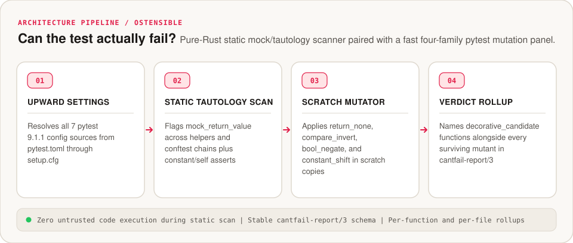
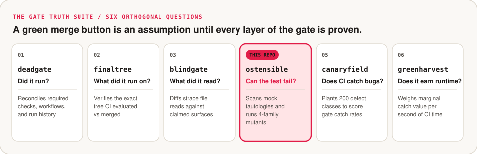

# Ostensible Architecture

Ostensible asks whether a Python `pytest` test can fail for a real reason. Its implementation is a zero-dependency pure-Rust crate (`src/`) organised into five deterministic stages so static analysis never executes untrusted code and dynamic mutation applies edits inside temporary scratch copies rather than modifying `<project>` in place.

  <picture>
    <source media="(prefers-color-scheme: dark)" srcset="https://raw.githubusercontent.com/david-engelmann/ostensible/main/docs/media/how-it-works-dark.svg">
    
  </picture>

## Pipeline Stages

### 1. Upward Collection Settings Resolver (`src/settings.rs`)

Before touching any test file, Ostensible walks upward from `<project>` to the filesystem root to find the single governing configuration source `pytest 9.1.1` would select. Within each directory, it checks the seven `pytest 9.1.1` sources in strict precedence order (`pytest.toml`, `.pytest.toml`, `pytest.ini`, `.pytest.ini`, `pyproject.toml` carrying `[tool.pytest]` or `[tool.pytest.ini_options]`, `tox.ini`, and `setup.cfg`) using its own pure-Rust TOML and INI readers. Custom `python_files` globs govern file discovery, `python_functions` and `python_classes` govern dynamic item selection, and `python_functions` governs static tautology scanning.

### 2. Pure-Rust Python 3.12 Lexer, Parser, and Static Scanner (`src/pyscan.rs`)

Ostensible embeds a complete pure-Rust Python 3.12 lexer, indentation/nesting-bounded parser, Unicode NFKC identifier normalizer, and `ast.unparse`-compatible expression renderer. Without importing or executing target Python modules, it resolves `conftest.py` chains from root to leaf (tracking shadowing, `yield` setup prefixes, `yield from` intra-module fixture delegation, fixture-decorated class poisoning, and top-level `if`, `try`, `for`, `while`, `with`, and `match` blocks in source order) to convict three tautology classes

- `mock_return_value` Asserting a call on a mock (or a local variable assigned from that call) against the exact value assigned to `.return_value` directly or through module helpers and `conftest.py` fixtures.
- `self_comparison` Comparing an expression directly to itself (`assert x == x`).
- `constant_assert` Asserting the literal constant expected by the assertion (`assert True`, `self.assertTrue(True)`, `self.assertFalse(False)`, `self.assertIsNone(None)`).

### 3. Four-Operator AST Mutator (`src/mutations.rs`)

For each discovered test file, Ostensible pairs stem-matching source modules (`test_calc.py` or `calc_test.py` pairs with `calc.py`, falling back to all discovered project modules when no stem match exists) and emits deterministic source mutants across four fast operators (`return_none`, `compare_invert`, `bool_negate`, and `constant_shift` by `+1` and `-1` on integer and floating-point constants).

### 4. Scratch-Copy Baseline and Mutant Runner (`src/runner.rs`)

Ostensible itself never modifies `<project>` in place. It copies the project (and any parent governing config file) into temporary scratch directories, runs passing baseline items first (`python3 -m pytest -q -p no:cacheprovider`), and evaluates each mutant inside a fresh scratch copy under the bounded `--timeout` deadline (note that scratch copies are not an OS filesystem sandbox around target `pytest` code).

### 5. Verdict Rollup and Deterministic Renderer (`src/model.rs`, `src/report.rs`)

Function verdicts (`can_fail`, `decorative_candidate`, `inconclusive`, `baseline_failed`, `no_applicable_mutants`) roll up to file-level verdicts under `FileVerdict::status()`, rendering byte-identically as human-readable text or sorted-key `cantfail-report/3` JSON.

  <picture>
    <source media="(prefers-color-scheme: dark)" srcset="https://raw.githubusercontent.com/david-engelmann/ostensible/main/docs/media/gate-truth-arc-dark.svg">
    
  </picture>

